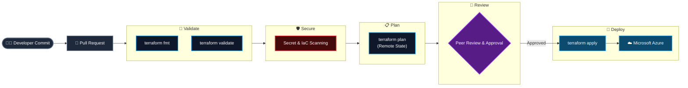
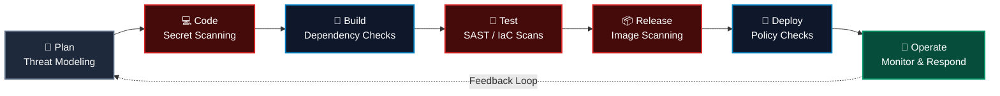

<div align="center">

<!-- Hero Dynamic Waving Banner -->


<!-- Dynamic Animated Typing Subtitle -->
<a href="https://github.com/iam-sourabhkumar">
  
</a>

<br />

<!-- Quick Navigation Bar -->
<p align="center">
  <a href="#about"><b>🧭 About</b></a> •
  <a href="#focus"><b>⚡ Focus</b></a> •
  <a href="#blueprints"><b>🏛️ Blueprints</b></a> •
  <a href="#arsenal"><b>🛠️ Arsenal</b></a> •
  <a href="#deepdives"><b>📂 Deep Dives</b></a> •
  <a href="#projects"><b>🌟 Projects</b></a> •
  <a href="#telemetry"><b>📊 Telemetry</b></a> •
  <a href="#connect"><b>💬 Connect</b></a>
</p>

<!-- Live Badges & Counters -->
<p align="center">
  <a href="https://komarev.com/ghpvc/?username=iam-sourabhkumar&style=for-the-badge&color=0078d4">
    
  </a>
  <a href="https://www.linkedin.com/in/sourabhkrdev/">
    
  </a>
  
  
  
</p>

---

</div>

<a name="about"></a>
## 💻 Terminal Identity

```bash
┌──(sourabh㉿devsecops)-[~/cloud-platform]
└─$ ./run-pipeline-inspection.sh --cloud azure --iac terraform --mode shift-left

[✔] Infrastructure as Code: Terraform modules, remote state, reusable patterns
[✔] CI/CD Pipelines: Automated build, test, scan and deploy workflows
[✔] Security Gates: Secrets, IaC and image scanning wired into pull requests
[✔] Cloud Platform: Microsoft Azure (also exploring AWS with Terraform)
[✔] Linux & Shell: Fundamentals to system administration and scripting
[✔] Learning in Public: Documenting every concept in open repositories
```

> *"Automate the repeatable. Secure it early. Document what you learn."*

I'm **Sourabh Kumar**, a **DevSecOps Engineer** based in **Bangalore, India**. I work at the intersection of **cloud infrastructure, automation, and security**: provisioning Azure environments with **Terraform**, building **CI/CD pipelines**, and embedding security into every phase of the delivery lifecycle instead of bolting it on at the end.

I also build in public. My repositories are a mix of **production-style Terraform code** and **practical learning hubs** covering Linux, DevOps, and DevSecOps from zero to hero.

---

<a name="focus"></a>
## ⚡ What I Work On

<div align="center">

| Area | Focus | What it means in practice |
| :--- | :--- | :--- |
| ☁️ **Azure Cloud** | Infrastructure on Microsoft Azure | Designing and provisioning repeatable cloud environments. |
| ⚙️ **Infrastructure as Code** | Terraform (HCL) | Reusable modules, remote state, and automated provisioning. |
| 🔁 **CI/CD** | Pipeline automation | Automating build, validation, and deployment with Git-based workflows. |
| 🛡️ **DevSecOps** | Shift-left security | Integrating security checks into every stage of the DevOps lifecycle. |
| 🐧 **Linux** | Administration and scripting | Commands, permissions, networking, and shell scripting. |
| 📚 **Knowledge Sharing** | Open documentation | Turning real-world implementations into practical guides. |

</div>

---

<a name="blueprints"></a>
## 🏛️ Architectural Blueprints

### 1. Terraform-Driven Azure Delivery Flow

How infrastructure changes move from a commit to a running Azure environment, with validation and review at every step.



---

### 2. DevSecOps: Security Across the Whole Lifecycle



---

<a name="arsenal"></a>
## 🛠️ Technical Arsenal

<div align="center">

### ☁️ Cloud & Infrastructure
<a href="#">
  
</a>

<br />


---

### 🛡️ DevSecOps, CI/CD & Version Control
<a href="#">
  
</a>

<br />


</div>

---

<a name="deepdives"></a>
## 📂 Deep Dives

<details>
<summary><b>⚙️ Terraform: How I Structure Infrastructure Code (Click to Expand)</b></summary>
<br />

* **Reusable Modules:** Break infrastructure into small, composable modules so the same pattern deploys consistently across environments.
* **Remote State:** Store state remotely with locking to keep teams safe from conflicting changes.
* **Multi-Cloud Awareness:** Patterns that apply to both Azure and AWS, with a focus on Azure.
* **CI/CD Integration:** Run `fmt`, `validate`, and `plan` automatically on pull requests before anything is applied.

</details>

<details>
<summary><b>🛡️ DevSecOps: Shifting Security Left (Click to Expand)</b></summary>
<br />

* **Catch Early:** Scan for leaked secrets and insecure IaC before code is merged.
* **Automate Gates:** Make security checks part of the pipeline rather than a manual step.
* **Least Privilege:** Prefer scoped identities and role-based access over broad permissions.
* **Feedback Loop:** Use findings from production monitoring to improve earlier stages.

</details>

<details>
<summary><b>🐧 Linux: Zero to Hero Learning Path (Click to Expand)</b></summary>
<br />

* **Fundamentals:** Filesystem, commands, and file management.
* **Access Control:** Users, groups, and permissions.
* **Networking:** Core networking concepts and troubleshooting tools.
* **Automation:** Shell scripting and system administration tasks.

</details>

---

<a name="projects"></a>
## 🌟 Featured Repositories

<div align="center">

| Repository | Tech Stack | Description |
| :--- | :--- | :--- |
| **[DevSecOps](https://github.com/iam-sourabhkumar/DevSecOps)** | `DevSecOps` `Security` | An approach to software development that integrates security into every phase of the DevOps lifecycle. |
| **[Terraform](https://github.com/iam-sourabhkumar/Terraform)** | `Terraform` `Azure` `AWS` | Production-ready Terraform for provisioning and managing cloud infrastructure: modules, state management, CI/CD integration, and best practices. |
| **[Monolithic-app](https://github.com/iam-sourabhkumar/Monolithic-app)** | `Terraform` `Azure` `HCL` | Terraform-based IaC project for deploying a monolithic application on Microsoft Azure with reusable modules and automated provisioning. |
| **[devops-insights](https://github.com/iam-sourabhkumar/devops-insights)** | `DevOps` `CI/CD` `HCL` | A practical knowledge hub for modern DevOps, Cloud, IaC, CI/CD, Automation, and DevSecOps practices. |
| **[Linux-Basic](https://github.com/iam-sourabhkumar/Linux-Basic)** | `Linux` `Shell` | A beginner-friendly Linux repo covering commands, permissions, networking, shell scripting, and sysadmin concepts. |
| **[infra](https://github.com/iam-sourabhkumar/infra)** | `Terraform` `HCL` | Infrastructure code repository. |

</div>

---

<a name="telemetry"></a>
## 📊 Live Telemetry & GitHub Metrics

<div align="center">

<!-- GitHub Achievements Trophy Case -->
<a href="https://github.com/iam-sourabhkumar">
  
</a>

<br /><br />

<table border="0">
  <tr>
    <td width="50%">
      
    </td>
    <td width="50%">
      
    </td>
  </tr>
  <tr>
    <td colspan="2" align="center">
      
    </td>
  </tr>
</table>

<!-- Live Activity Graph -->
<a href="https://github.com/iam-sourabhkumar">
  
</a>

</div>

---

<a name="connect"></a>
## 💬 Let's Connect & Collaborate

I'm happy to connect with engineers and teams to talk about:
- ☁️ Building and automating **Azure infrastructure with Terraform**
- 🛡️ Adding **security gates to CI/CD pipelines**
- 🐧 **Linux and DevOps** learning paths
- 🤝 Collaborating on **open-source DevOps and DevSecOps** projects

<div align="center">

<p align="center">
  <a href="https://www.linkedin.com/in/sourabhkrdev/">
    
  </a>
  &nbsp;
  <a href="https://github.com/iam-sourabhkumar">
    
  </a>
</p>

<br />

<p align="center">
  <i>"If it has to be done twice, automate it. If it has to be trusted, secure it. If it has to be learned, document it."</i>
</p>

<p align="center">
  <strong>⭐ Star my repositories if you find them useful! ⭐</strong>
</p>

<!-- Dynamic Footer Wave -->


</div>
